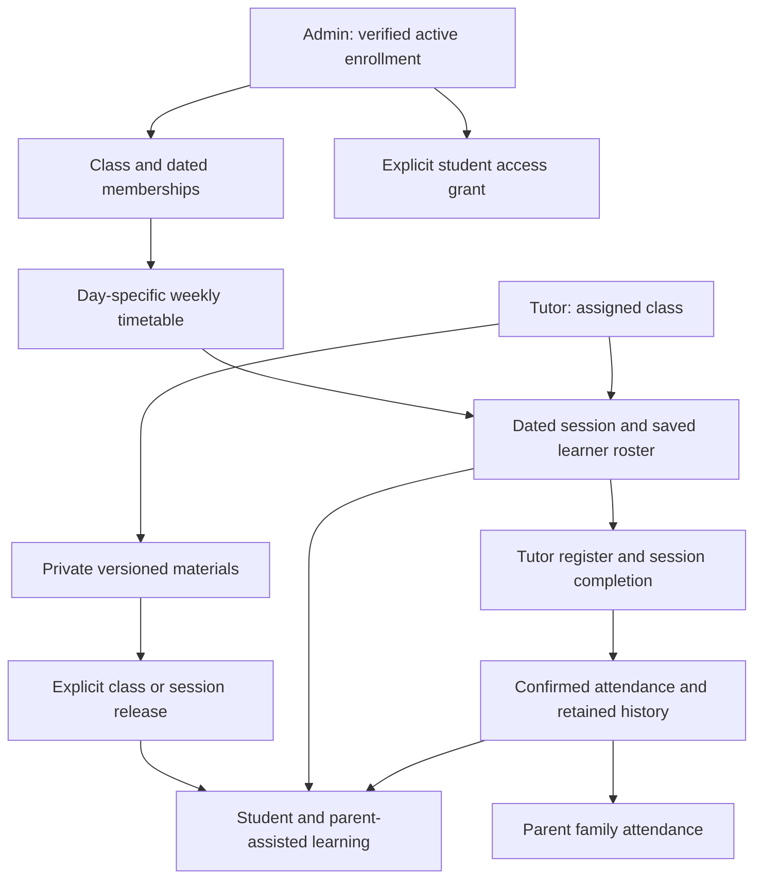

# Connected portals: release 2 setup and testing

The academic follow-on release is now implemented separately. After this setup, follow [academic-workflow.md](academic-workflow.md) to enable assigned work, submissions, marking/publication, timed assessments and progress/report PDFs.

Recorded 27 October 2026, South African time. This guide describes implemented
code. Deployment acceptance in your Supabase/Vercel project is still required.
No database reset is needed. Tuition amounts, activation, accounting and payment
policies are unchanged.

## What this release implements

- Fixed mobile docks rendered outside page containers in admin, parent, tutor
  and student portals. Bottom clearance and device safe-area padding; desktop
  navigation remains available. Dashboard footer branding removed; Privacy kept.
- Portal support uses WhatsApp +27 73 391 3206, with editable contextual messages.
  Opening a link does not send a message or guarantee a response time.
- Tutor Home, Schedule, Classes, Materials and More. Today/Upcoming/Needs
  completion/Past session views use stored records. Class-scoped topic creation,
  scheduling, upload/verification, resource assignment/release and attendance.
- Day-specific saved timetable slots, availability previews, weekly repeats up
  to twelve dates, and rescheduling either one future session or remaining
  future sessions in its weekly series. Conflicts/closures are never silently
  skipped. Saving is atomic and stable request IDs prevent duplicate retries.
- Student `/student`: Home, Classes, Learn, Progress and More, with real learner
  details, subject starting/target marks, timetable, online rooms, upcoming and
  past sessions, confirmed attendance and released versioned files.
- Student email-link sign-in with separate HttpOnly cookies. Staff explicitly
  enable a learner's own enrollment email. One independent learner per unique
  sign-in email; sharing a guardian email uses parent-assisted learning instead.
- Parent Home includes an explicitly labelled read-only parent-assisted learning
  view for active children, through the existing parent session/family scope.
- Staff-only and learner-released attachments are distinct. Existing attachments
  default to staff-only; nothing becomes learner-visible just by upgrading.

## How records connect



Learner IDs, not names, join these records. Access is checked server-side for
reads, writes and file downloads. Tutors cannot grant accounts, edit rosters,
change finance or manage another tutor's classes. A tutor can version uploads
owned by their assigned class; they cannot replace an unrelated shared resource.

## 1. Download the setup package

Sign into GitHub with access to the private repository, open:

https://github.com/VuyolwethuM6/viva-learning-hub/blob/work/docs/downloads/viva-teaching-setup.zip

Click **Download raw file** (download arrow), then extract the ZIP. A private
repository's raw URL may return 404 when opened without an authenticated session.

The package contains:

- `teaching-setup.sql`: complete foundation plus release 2, for new installations
  or a safe complete rerun after parent setup.
- `connected-portals-upgrade.sql`: release 2 only, for installations that already
  applied the first teaching release.
- `connected-portals.md`: this guide.
- `teaching-test-guide.md`: the original foundation tests, with release 2 updates.
- `shared-portal-signin-email.html`: shared Supabase Auth email template.

## 2. Run the database upgrade

If your first teaching release works, open `connected-portals-upgrade.sql`, copy
**all** of it into Supabase SQL Editor, and run it once. Ensure the final
`commit;` is included. Do not copy only a selected fragment from inside a
function. If the prerequisite check says the teaching foundation is missing,
run the complete `teaching-setup.sql` instead, after your parent setup.

Both files preserve existing records and may be rerun. Existing classes receive
initial slots from their old selected days/times. Previously retired slots stay
retired on reruns. Existing sessions retain their dates, roster and files.

Verify:

```sql
select to_regclass('public.teaching_slots') as timetable,
       to_regclass('public.student_accounts') as student_access,
       to_regprocedure('public.student_snapshot(uuid,text,uuid)') as student_read,
       to_regprocedure('public.teaching_series_preview(uuid,text,uuid,date,uuid)') as series_preview;
```

All four values should be present.

## 3. Configure student email sign-in

Keep the working Supabase Email provider and SMTP settings already used by the
parent/tutor portals. Add the exact student callback to Supabase Authentication
URL Configuration → Redirect URLs:

`https://YOUR-WORK-PREVIEW-HOST/api/student?action=callback`

Keep the existing parent and tutor callbacks too. Use the preview host belonging
to your `work` branch, not a localhost address. Add production callbacks when you
choose to deploy there. Preview deployment protection may still ask you to sign
into Vercel; that is separate from portal authentication.

In Vercel Preview settings, set `STUDENT_PORTAL_URL` to that HTTPS origin if it
is different from `PARENT_PORTAL_URL`. Otherwise it falls back to the parent
origin, then `PUBLIC_SITE_URL`. The origin has no `/student` suffix. Redeploy
after changing environment settings and wait for Vercel to show **Ready**.

Use the supplied neutral email template for both **Magic Link** and
**Confirm Signup**. The link must remain:

```html
<a href="{{ .RedirectTo }}&amp;token_hash={{ .TokenHash }}">Open my Viva portal</a>
```

Do not replace `.RedirectTo` with a fixed parent, student or tutor URL. Allow new
Auth signups for first-time identities; only explicit database grants provide
portal access. Unknown/disabled accounts get the same request acknowledgement
but no email. If no mail arrives, check the grant and active enrollment before
SMTP. No student password or code entry is required.

## 4. Prepare one controlled test family

1. Use a test learner with a verified document, reviewed application and recorded
   first payment. Activate the learner using the existing admin workflow.
2. Confirm enrollment has the learner's own email and the correct guardian
   email. Use different controlled inboxes for an independent student login.
3. Admin → Classes → **Student portal access** → select learner → Enable →
   reason → Review choices → Confirm and save. This does not send an invitation.
4. Open `/student` in another browser/profile, enter that email and use the
   newest email link. Shared guardian/learner email is deliberately rejected
   for independent access; use parent-assisted learning for that case.
5. Keep Parent access enabled through the existing learner profile controls.

Enrollment email duplicates are not globally prohibited: siblings may share a
guardian. A student grant with an email already assigned to another learner is
rejected. A verified email alone cannot select a different learner.

## 5. Configure and test the day-specific timetable

1. Admin → Classes: authorize a tutor, save a real room/HTTPS meeting link,
   create a class and add eligible active learners.
2. The class form seeds afternoon weekday times 16:00–19:00 or Rewrite
   09:00–12:00. Rewrite suggests mathematics Monday/Wednesday/Friday or sciences
   Tuesday/Thursday/Friday; choose the actual teaching days for the class.
3. Open the class's **Weekly timetable**. Retire Tuesday's original 16:00–17:00
   slot, then Add day-specific time → Tuesday → 17:00–18:00 → reason → confirm.
4. Schedule session: choose Monday and verify Monday's 16:00–17:00 slot appears;
   choose Tuesday and verify 17:00–18:00 appears instead. Dates are examples;
   choose actual valid dates in the class teaching year.
5. Try a closure, an out-of-season date or an occupied tutor/room/learner time.
   It must be unavailable. There must be no successful silent partial booking.
6. Choose Weekly, an end date within 12 occurrences and a topic. Review the
   preview of **every** date before saving. A conflict blocks the whole series.
7. Reschedule a future occurrence. Choose **This session only**, then verify
   its original is cancelled and a replacement appears. For a weekly series,
   choose **This and later sessions**: every replacement date is previewed and
   saved together. Earlier/completed occurrences remain unchanged.

Slots remain distinct from dated sessions: retiring/adding a slot does not move
already scheduled teaching. Use explicit rescheduling for those sessions.
Weekend hours must be configured by Viva; no hours are invented from “Available”.
Sunday is Grade 12 online feedback. Programme eligibility and tuition proration
stay unchanged (Rewrite proration still counts all five weekdays).

## 6. Tutor materials and student access

1. Tutor signs in at `/tutor` → Classes → select assigned class → Add topic &
   goal → create a reusable topic; Schedule session selects saved day/time.
2. Materials → select assigned class → Upload teaching material (PDF/JPEG/PNG,
   up to 10 MB) → review → confirm. Wait for upload verification.
3. Back in Classes → Assign resource → select that version. It is **Staff-only**.
4. Student → Learn: it must not appear yet. Trying a copied file ID must also
   fail at the API, before Storage download.
5. Tutor → Release to learners → review and confirm. Student → Learn or Refresh:
   the resource appears and opens in the document viewer/download.
6. Return the attachment to staff-only and refresh. New downloads must be
   denied unless another class/session attachment explicitly releases that same
   version. Copies already downloaded to a device cannot be recalled.
7. Test a session-specific release too. New sessions copy class attachment
   versions and release flags at creation; changing a class default does not
   silently alter old session attachments.

Only released versions reach students/parent-assisted views. Memos and assessment
papers remain staff-only until a deliberate release. Public `/study-materials`
prices, purchase flow and publication remain separate.

## 7. Attendance and the four-portal journey

Use a session that has already ended for completion testing (admin can schedule
an historical test session within the allowed season/day/time). Do not change a
production database clock to make a session end sooner.

1. Tutor → Schedule → Today/Upcoming/Needs completion/Past. Open the session.
2. Record explicit attendance for every learner; no present/absent default.
3. Before completion, parent/student attendance must remain unconfirmed.
4. Complete the ended session, choose teaching outcome and optionally add a
   private staff note.
5. Student → Progress: correct attendance appears; the private staff note does not.
6. Parent → Home → Classes & attendance: same confirmed record. Open
   **Parent-assisted learning view**: correct child's timetable and released
   resources, labelled assisted rather than an independent student exam session.
7. Correct attendance with a reason and check the update/history. Cancelled
   sessions must never become absences; excused sessions do not lower the rate.
8. Remove a tutor assignment/disable account or disable student access: later
   requests must fail. A sibling/unrelated family must not see these files or
   learner records. Finance stays visible only to authorised admin/parent roles.

## 8. Mobile and contact checks

On admin, parent, tutor and student: scroll to the middle/end and back, rotate
portrait/landscape and open the keyboard. The bottom dock should remain at the
viewport bottom and the last content/button must remain reachable. Open More,
logout and document dialogs; they should fit the screen and scroll internally.
Test Chrome and Safari on an actual phone too: cloud browser engines do not
reproduce every browser toolbar, keyboard or operating-system behaviour.

WhatsApp links should open the Viva number with the appropriate editable
message. Sending remains the user's action. Dashboard footer branding should be
absent, while Privacy is still accessible.

## Academic follow-on and remaining features

Activities/homework/submissions, server-enforced timed assessments, diagnostic/formative/summative human marking, review/publication, period averages and report PDFs are implemented by the separate academic migration. Curriculum practice, study plans, XP/badges, leaderboards, Ask Vito and public materials CMS remain future work.

The supplied prototypes include Firebase contexts, sample leaderboard users,
client-side scoring/timers and reset-progress buttons. These are design
references, not connected production services. Official attendance/history is
never reset by students. The next assessment phase must define independent
identity for learners without their own email, late-work/retry rules, weighting,
report periods and publication permissions before enabling that workflow.

## Local verification for this release

180 tests across 20 files passed, including actual PostgreSQL/PGlite permissions,
series/single rescheduling, idempotent retries, learner scope, parent-assisted
reads and material-release/download authorization. Both TypeScript targets passed.
Lint has zero errors and seven existing Fast Refresh warnings. The production
build exited 0; baseline SSR/useLayoutEffect and post-prerender shutdown messages
remain. The complete four-portal Chromium journey and mobile WebKit checks use
actual HTTP handlers/SQL with simulated Auth, Storage and mail, not live services.
