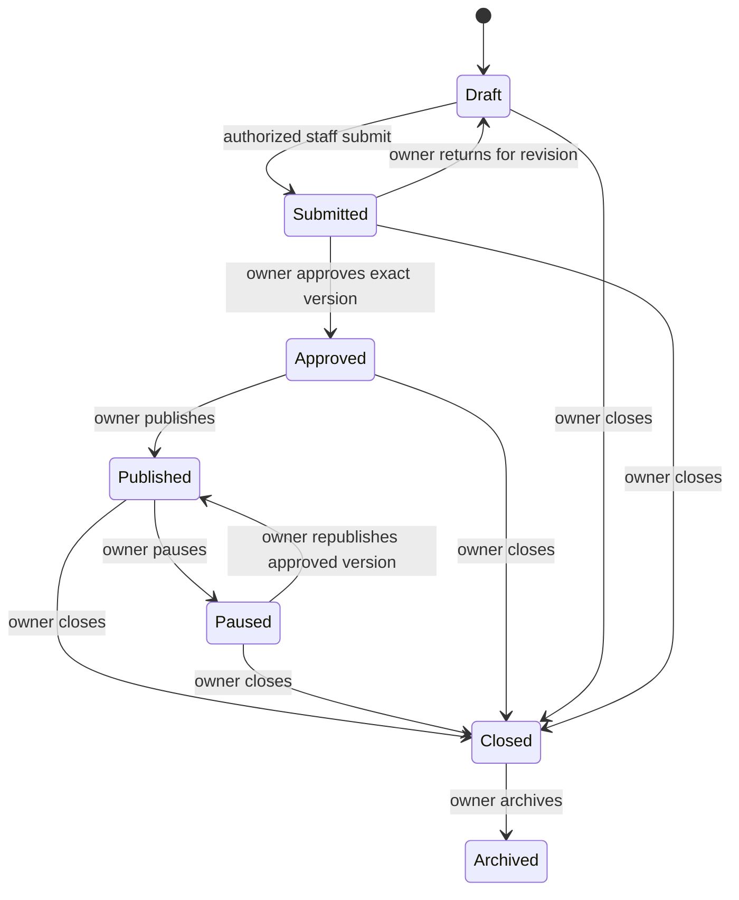

# Milestone 2 — vacancy management and public Careers

This extends the unified Supabase recruitment domain after `3f1ffee` and `e8024b4`. It does not create a separate application, identity system or hosted database. Implementation/testing uses isolated local PostgreSQL fixtures and synthetic Auth; no live migration, feature change or Auth setting is implied.

## Data and workflow

`recruitment_vacancies` holds the stable reference/slug, authorized scope, current revision, lifecycle status, review state and version pointers. `recruitment_vacancy_versions` stores append-only structured content. Separate append-only approval and publication records bind owner decisions to exact versions. `recruitment_vacancy_assignments` supplies explicit officer assignment in addition to an active scope grant.

Owner creation can atomically create a dedicated vacancy scope and vacancy, avoiding orphan scope records. Owners/managers can also select an existing authorized vacancy scope; managers cannot create ungoverned scopes. Content has exactly one category and engagement type. Legal engagement (`employee`, `independent_contractor`, `volunteer`) is distinct from schedule (`full_time`, `part_time`, `flexible`) and location arrangement (`onsite`, `remote`, `hybrid`). JSONB content retains typed bounded arrays, numeric positions, UTC timestamps, document descriptors and future question definitions, validated by TypeScript and PostgreSQL. Generated category/engagement columns support database filtering/reporting.

A saved draft requires a valid title/category/engagement and field types. It may be incomplete. Submission and approval require department, location, summary, responsibilities, minimum requirements, experience, schedule and opening/closing dates with a future deadline. Tutor vacancies additionally require subjects and grades; other categories do not. API content is bounded to 15 KB, database content to 16 KB (allowing PostgreSQL JSON formatting overhead). Document/question descriptors are configuration only: no applicant information, uploaded files or answers are collected.

A live vacancy can simultaneously have a new working revision. `status` remains `published`/`paused` while `review_state` becomes draft/submitted/approved. Public reads use only the previously published, approved snapshot until owner republication. Saving creates a new immutable version rather than editing an earlier snapshot. Closed/archived records cannot reopen. A passed deadline reports `closed` availability even if staff have not yet administratively closed the published listing. Application acceptance is always false in this milestone.

## Authorization and integration

- Owners govern all vacancies, final approval, publication, return, pause, closure, archival and public visibility.
- Managers create/edit/submit/revise only within active authorized scopes, and assign scoped officers to vacancies they manage.
- Officers edit/submit/revise only where both active scope membership and explicit vacancy assignment exist. They cannot create vacancies or take owner-only transitions.
- Assignment removal remains possible without target authentication; new assignments require an enabled, verified, scoped officer. Self-assignment changes are denied.
- API checks provide coarse role defense. Database functions recheck current actor, role and scope before idempotent replay and under the existing settings lock for mutations.
- Existing action-specific password confirmation, session rotation, optional owner AAL2, request IDs, challenge consumption, expected revisions and append-only audit apply to vacancy operations. API callers cannot supply their own trusted assurance.
- Browser roles have no direct table writes/RPC execution. The existing server credential can invoke only the selected private/public projection RPCs. Governance and operational recovery stay isolated from general Admin/teaching/finance identities.

The workspace lives under `/admin/recruitment`, alongside Security and governance. Existing Admin navigation already links to that isolated entry. A pending request defaults to Governance recovery after reload; only the UUID is stored in session storage, with payload and result recovery authorized server-side. No new ID is automatically generated for an uncertain action.

## Public boundary and caching

`public_vacancies_enabled` defaults false. Its reviewed owner operation uses the existing recruitment settings revision and audit domain. Publication/visibility changes advance a generation counter. All other intake/upload/interview/hiring/onboarding/activation/compensation features remain unavailable.

`GET /api/careers` and `/api/careers?slug=...` use a whitelisted database projection plus API validation. Only database-published versions linked to immutable approvals can appear. No staff identity, draft pointer, assignments or audit content crosses the public boundary. Category filtering and pagination operate server-side. Details are one record; list pages contain at most 20. Private lists/history are also bounded; content is not duplicated into every audit event because immutable version/request evidence is retained.

ETags hash the actual public representation, including visibility generation and time-derived availability. `Cache-Control: public, max-age=0, must-revalidate` permits storage but requires authoritative database revalidation before every 304. Errors use `no-store`; stale data is not served on revalidation failure. Pause, close and flag-off cannot be hidden by a stale CDN time-to-live. No process-local cache is treated as authorization.

Careers cards link to `/careers/:slug`. Detail metadata is populated only after validated public data; unavailable/loading details are noindex. Dynamic detail pages are not enumerated from production during build-time prerender. No JobPosting structured data or functional-looking Apply control is emitted while application intake is unavailable. Talent-pool preparation is informational only, with no personal-data form.

## Existing systems preserved

No changes to learner enrollment schemas, academic tasks/grades, teaching sessions, tutor identity/bindings, accounting journals/lines, suppliers or compensation processing are part of this milestone. Existing recruitment owner recovery, mandatory safeguard locks and opt-in AAL2 remain in force. Public rollout requires separate live migration/feature/deployment approvals; see deployment instructions.
