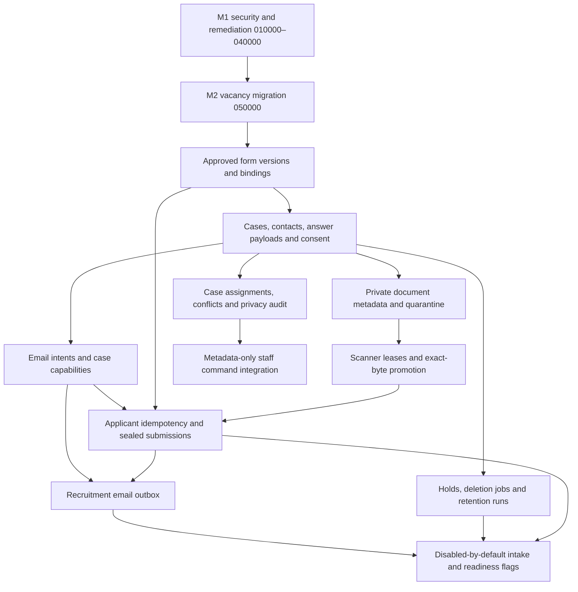

# Proposed M3 schema and migration dependencies

**Status update: M3.1 has an implemented local-only additive migration.** See [phase-1/architecture-and-contracts.md](phase-1/architecture-and-contracts.md) for the exact thirteen-table foundation, privileges and interlock. No production SQL has been executed. The remaining logical entities and slices below are the original later-phase proposal, not implemented migrations. Every live migration still requires target inspection and separate execution approval.

## Dependency graph

M2 acceptance changes only the UI history request race; its canonical SQL remains unchanged. Before M3, confirm the actual target has the reviewed M1/M2 definitions, all five M2 vacancy tables and current function grants. Do not infer installed state from repository files or execute the old M1 bundle after M2.

## Proposed entities and relationships

The following are logical tables; implementation may consolidate tables only if retention, actor and access boundaries remain explicit.

| Proposed entity | Essential fields/constraints and relationships |
| --- | --- |
| `recruitment_intake_forms` | UUID; purpose `vacancy`/`talent_pool`; category (required for vacancy forms, null for the general-pool form); code-template revision; optional exact M2 vacancy/version composite FK; bounded schema JSON/digest; notice/policy versions; approved owner/time. Immutable definitions. Vacancy forms must match the approved vacancy category/questions/documents; pool forms cannot masquerade as vacancy forms. |
| `recruitment_intake_form_bindings` | Vacancy/version or unique pool scope → active approved form ID; enabled/default false; revision. One active binding per purpose/version. Owner-only activation; changing templates never mutates existing forms. |
| `recruitment_cases` | UUID/opaque human reference; kind; scope; exact vacancy/version/publication/form pins or pool reference; state/revision; created/submitted/withdrawn/unsuccessful timestamps; last valid applicant activity; expiry/retention/deletion state. Exactly one intake kind; no Auth-user requirement. Closed vacancy cannot gain a new submission through a pinned historical version. |
| `recruitment_case_contacts` | Case FK; normalized email and purpose-scoped HMAC/index-key version; email revision/verified time; minimal contact data. Deletable PII. No broad cross-purpose identity directory or automatic link to a tutor/account. |
| `recruitment_case_payloads` | Case FK; payload revision/kind `draft`/`submitted`/`correction`; bounded answers; notice/declaration references; timestamps/sealed state. Ordinary editing ends when sealed; authorized erasure still removes PII. Corrections append a new governed payload instead of overwriting a prior submitted answer silently. |
| `recruitment_email_challenges` | Optional case/intent binding; purpose; normalized pending email/digest and email revision; proof hash; expiry/resend/attempt state; consumed/revoked times. Short-lived verification intents are purgeable and do not grant an application account. |
| `recruitment_applicant_sessions` | Case FK; random capability hash; email revision; permitted actions; idle/absolute expiry and revocation; optional rotation predecessor. Narrow case authorization, independent of `auth.users`. No plaintext session token. |
| `recruitment_case_documents` | Case/form requirement FK; generated document/generation IDs; private quarantine/clean object identities; declared/actual size/type; checksum; scan/policy state; created/finalized/deleted times. One current generation per required item; no duplicate mutable path as clean evidence. Original names, if retained for applicant UX, are PII and are purgeable. |
| `recruitment_document_scans` | Document generation FK; scan job ID; lease/attempt/backoff; callback nonce/digest; engine/signature/policy versions; checksum; verdict/timestamps. Unique accepted verdict per generation and content identity; stale callbacks cannot change a replacement generation. |
| `recruitment_submissions` | Case FK; exact sealed payload/form/vacancy/publication pins; opaque receipt ID; submitted time; referenced clean document IDs/digests. One accepted submission per case; document references must belong to that case and pass the pinned policy. Payload deletion is governed, not blocked by immutable generic logs. |
| `recruitment_case_challenges` | Staff Auth/session hash; case/request/operation; expected revision and staged keyed digest; five-minute proof hash; consumed/expiry state. Reuses M1 proof semantics in a case-retention-governed store, without adding permanent case references to M1 journals. |
| `recruitment_case_requests` | Stable actor kind/principal (case-bound applicant principal or staff Auth UUID, never a rotating capability/session ID); request UUID; operation; keyed canonical payload digest; state and opaque receipt/result reference; expiry. Unique actor/case/request key, reject changed reuse. No contact/answer/document-name payload copies. Purge with case/approved request policy. |
| `recruitment_case_assignments` | Case FK; staff Auth FK; assigned role/state/revision; granting actor/time. Separate from M2 editing assignments so case review may continue after vacancy closure. New assignments require active eligible scope grants; removal must work after target disable/unverification. |
| `recruitment_case_conflicts` | Case/staff binding; coded conflict/source; declaring/independent actor; timestamps/review. Active conflicts deny PII access even for owners and survive staff/applicant email changes until independently resolved. Protect evidence; no self-approval of conflict removal. |
| `recruitment_case_notes` | Case FK; staff Auth actor; typed note/clarification/recommendation and bounded text; revision/timestamps. PII-retention governed; absent from applicant reads and generic immutable M1 payloads. Recommendations do not set final hire/reject state. |
| `recruitment_staff_change_buffers` | Case/staff session binding; short expiry; expected revision; purgeable proposed note/contact change; keyed digest; consumed state. Existing reauth proofs bind only metadata and digest, never free-text applicant PII. |
| `recruitment_consent_events` | Case/purpose; affirmative action or withdrawal; notice/consent version; verification basis; time/expiry. Append-only to ordinary roles, but retained/deleted under an approved proof-retention policy. Vacancy notice acknowledgement is not automatic pool or marketing consent. |
| `recruitment_case_audit` | Opaque case/actor-kind references, coded action, versions/digests and time; no emails/names/answers/file names/free-text notes. Normal insert-only permissions plus a specifically authorized retention-pruning path for this new audit domain; existing M1 immutable triggers stay unchanged. |
| `recruitment_privacy_holds` | Case/purpose/specific object scope; authority and protected evidence reference; reason code; start/review/release. Case-lock synchronization with purge; holds do not revive sessions or permit recruitment outreach. |
| `recruitment_deletion_jobs` | Case/object references; lease/retry; deletion phase/irreversible barrier; storage verification; error codes and completion time. Deletable operational references once the approved erasure-evidence retention ends. Never report success while storage/PII remains. |
| `recruitment_retention_runs` | Run ID, policy version, start/end, aggregate counts and sanitized failures. Minimal operational evidence; avoid permanent applicant references. |
| `recruitment_email_outbox` | Intent/case/purpose/template reference; claim token, attempts/backoff, provider idempotency reference and status. No permanent plaintext mail body/recipient/token archive. Short-lived encrypted verification-delivery envelope, scrubbed on send/expiry; confirmation data loaded only while still authorized. |

An additional independent talent-pool registration table may be used if required to keep consent/renewal separate from common case metadata; it must retain the same single-purpose PII boundary. Do not add applicants to learner `applications`, `tutor_assignments`, `teaching_tutors`, `portal_users` or `auth.users` to satisfy an existing FK.

## Constraints, indexes and actor model

- Keep random case/document/session identifiers independent of applicant names/email. A public receipt/reference is not a bearer credential.
- Enforce foreign-key consistency across vacancy/version/form/publication and across case/document/submission relationships, not only independent UUID existence.
- Index current case eligibility, `(scope_id,submitted_at,id)` queues, active staff assignments/conflicts, due expiry/retention, outbox leases and document scan state. PII search joins only after staff case authorization; use purpose-keyed email indexes, never a public email lookup.
- Proposed duplicate policy: one active case per verified normalized email/purpose/vacancy, independent from published revision. Partial uniqueness/transaction locks must account for withdrawal, retention and HMAC-key rotation. Business approval is required before locking this policy into DDL.
- Sessions/proofs depend on the exact email revision. Deleted/revoked cases cannot mint sessions or reserve/promote documents.
- Protect submitted payloads from ordinary update; privacy erasure uses a purpose-built authorized path, not `DISABLE TRIGGER`, blanket grants or rewriting M1 history.
- Case audit supports applicant/staff/worker actor kinds. Staff actor FKs may reference Auth; applicant actor IDs must not require an Auth account. Avoid FK cascades from retained audit that prevent legitimate PII erasure.

## Proposed migration slices

| Slice | Depends on | Contents and acceptance prerequisite |
| --- | --- | --- |
| M3-A — forms/cases/privacy core | Reviewed M1/M2 + acceptance fix | Default-off settings, immutable form definitions/bindings, cases/contacts/payloads/consents/holds, actor model. Approve schema and finite retention triggers before storing PII. |
| M3-B — verified applicant capability | A | Email intents/sessions/idempotency, dedicated cookies, generic initiation/recovery responses, outbox leases. No uploads/submission enabled. |
| M3-C — documents and scanner | A/B + approved scanner/operator | Private bucket configuration, document generations/scan jobs, exact-byte promotion/download authorization. Upload flag cannot be enabled until real scanner acceptance. |
| M3-D — sealed submissions | A/B/C | Atomic eligibility/version/document checks, immutable receipt and seal semantics, transactional confirmation job. All external calls occur after commit. |
| M3-E — staff management | A/D | Case-specific assignments/conflicts/notes/staging; strict metadata-only case reauth using M1 Auth/session helpers; conflict-filtered reads. No final decisions or activation. |
| M3-F — retention/operational rollout | A–E | Leased purge/orphan/mail/scan reconciliation, erasure verification, rights-request operations and owner-controlled readiness flags. Complete real provider/Storage/backup rehearsals before intake. |

These names describe sequence, not executable migration files. Timestamp/file names are chosen only during approved implementation. Fresh-schema and transactional upgrade bundles must remain exact copies of canonical migrations, with regression tests for populated M1/M2 identity, tutor, academic and ledger preservation.

## Authorization and transaction dependencies

New tables enable RLS and revoke direct browser/ordinary-role access. Expose only narrow service RPCs. Staff calls derive actor/assurance from existing recruitment Auth; applicant calls derive authority from a valid case-capability hash; workers use separate purpose-bound secrets/leases. Never allow a body parameter to select its own trusted role, actor, scan verdict or email-verification state.

Submission/rebase/upload grants acquire locks consistently with M2: settings then vacancy then case/session/document records; use `FOR SHARE` where it must conflict with status/flag changes. Check real clock time after waits. Staff conflict/assignment changes and all legal hold/purge transitions serialize on case state. Use `SKIP LOCKED` for bounded background work, never as an eligibility shortcut.

The existing immutable `recruitment_requests` remains for governance, including non-PII form definitions. It receives neither applicant PII nor permanent case references: even opaque case links require a retention basis. Applicant and staff case idempotency/proof records use new purgeable case tables, with the same stable-request/action-proof semantics and existing Auth/session validation helpers. Do not invent Auth applicants or weaken immutable M1 triggers.

## Live migration and recovery gates

Before any production execution: inventory exact target definitions/default privileges/overloads; confirm M2 and acceptance changes installed; check object-name conflicts; validate existing data/FKs and role inheritance; rehearse upgrade/restore; measure lock and response sizes; approve scanner/storage/mail regions and access; present exact SQL/checksum/impact/rollback for explicit approval. No live feature is enabled by migration defaults.

Before commit, failed validation rolls back the transaction. After PII exists, prefer audited forward fixes and disabling new intake over destructive schema rollback. Preserve recover/withdraw/privacy access while intake is disabled. Object deletion is not transactional with Postgres: failed purges remain queued and visible operationally. Do not drop tables, erase case history indiscriminately or remove M1 safeguards to make a rollback pass.

Backups require an erasure replay ledger with its own approved retention/access boundary. Restoring a backup must not reactivate old email proofs, applicant sessions, revoked consent or erased cases. Scanner/outbox leases are invalidated on recovery and reissued only after state reconciliation.
