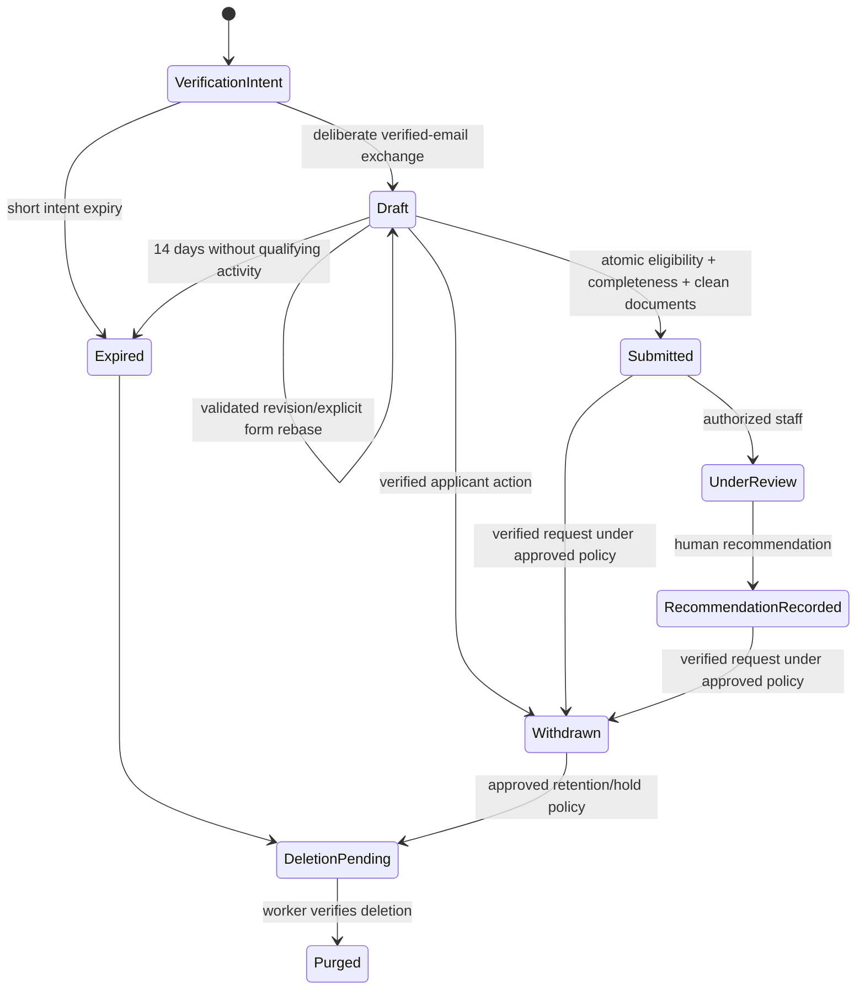
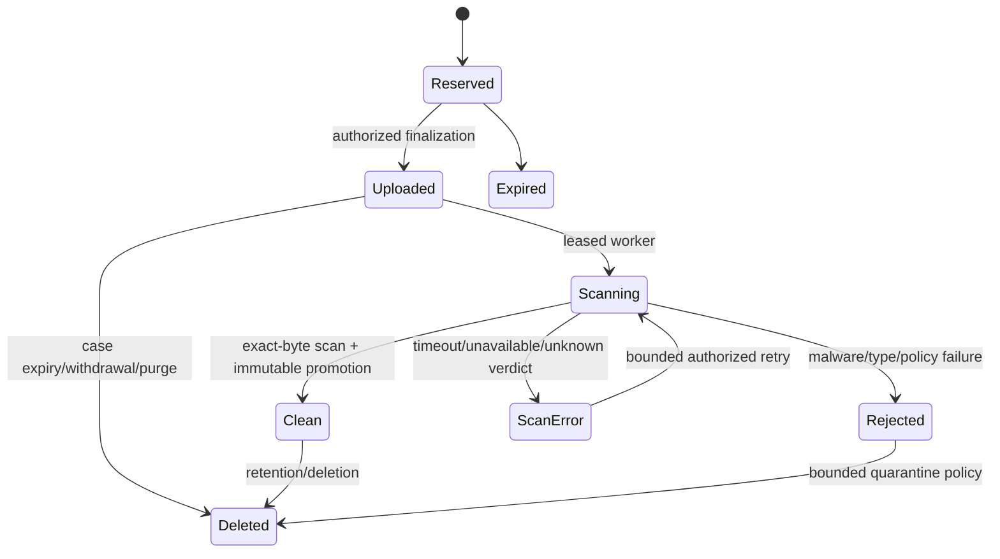

# Milestone 3 technical design — application intake and talent pool

**Status: conditionally authorized; M3.1 foundation implemented locally only.** Baseline is Milestone 2 at `59613eca0fa4d242d1dcec7d2bc03a3818486227`, followed by focused M2 acceptance fix `e29ef09`. The exact M3.1 contracts and accepted business decisions are in [phase-1/architecture-and-contracts.md](phase-1/architecture-and-contracts.md). The remaining sections describe later phases, not completed functionality. No applicant endpoint, bucket, scanner, email job or live flag has been enabled. The existing unified Supabase backend, Node API, staff Auth and recruitment owner authority remain authoritative.

## 1. Scope and boundaries

Propose verified-email, accountless applications to published vacancies; role-specific forms; recoverable private drafts; scanned private documents; final submission/receipt; scoped staff case management; independent talent-pool consent; and operational retention/deletion. Screening checks completeness only. No model/AI assesses suitability, scores candidates or makes hiring decisions.

M3 does not redesign enrollment or academic learning, replace `teaching_tutors`, change accounting or activate any account. Interviews, final hiring/rejection, agreements, onboarding and system activation remain separately authorized future work. Staff can record recommendations, not final hiring decisions. Whether owner-only unsuccessful closure enters M3 is an explicit scope decision in [the approval checklist](implementation-plan.md); it is not silently introduced as a new status name.

## 2. Verified foundation and safe reuse

| Existing evidence | Reuse and constraint |
| --- | --- |
| `api/_lib/recruitment-auth.ts:56`, `api/_lib/recruitment-security-service.ts:30` | Keep dedicated staff cookies, provider-validated identity, fresh password/session rotation and required owner AAL2. Applicant access must not substitute for these. |
| `supabase/migrations/20261109050000_recruitment_vacancies.sql:173` | Reuse current authority, expected revisions, serialized state transitions, exact replay and immutable vacancy/version relationships. Submission needs a separate applicant actor model. |
| `supabase/migrations/20261109010000_recruitment_foundations.sql:38` and `:83` | Existing requests store full payloads and require an Auth user; requests/events are immutable. Never send applicant answers, contact data, filenames, notes or email tokens into this mechanism. |
| `src/components/admin/recruitment/VacancyWizard.tsx:185`, `src/pages/Enrollment.tsx:320` | Reuse accessible step navigation, review/edit interaction, loading/error patterns and shared UI primitives. Keep applicant schema/state separate from learner enrollment. |
| `api/_lib/email.ts:11`, `api/_lib/enrollment-emails.ts:234` | Keep the existing email provider/sender infrastructure and claim/retry concepts. A recruitment adapter needs sanitized provider errors and purpose-specific recipients; the shared helper currently logs provider response bodies and requires `ADMIN_EMAIL`. Do not copy those behaviors into applicant processing. |
| `api/_lib/teaching-service.ts:83` | Authorize the record before granting document access; use bounded bytes/type checks and attachment/nosniff headers. Never adopt UUID-only draft access from `api/enrollment-upload-url.ts:25`. |
| `supabase/migrations/20261109050000_recruitment_vacancies.sql:290` | Public Careers projection is informational and always returns `acceptingApplications:false`. It is not a submission authorization function. |

No separate hosted project is required by this design. Local fixtures remain useful; inspection and approval of the actual unified target are mandatory before any live migration.

## 3. Dynamic forms and immutable requirements

Use a restricted, versioned schema renderer, not executable administrator-provided code. An immutable `recruitment_intake_forms` record composes:

- A reviewed version of common contact, experience, availability and privacy fields.
- Tutor, administrator or support-staff sections. Tutors select relevant subjects/grades and provide qualification/experience information; administrators provide functional/office experience; support staff provide role-relevant practical experience. Do not ask other categories for tutor-only fields.
- The exact published M2 vacancy version's `questions` and `requiredDocuments` definitions.
- Bounded document policy and the privacy notice version shown to the applicant.

Initial custom response types stay compatible with M2: `text`, `yes_no`, `number`. Base schemas may use bounded enums/multiple selections for known category fields. All field IDs, types, lengths, option sets and required conditions are allowlisted and validated in server code and SQL. No arbitrary HTML, expressions, regular expressions, URLs or dynamic JavaScript are accepted. Unknown answer keys, hidden-role answers and non-finite numeric values fail validation. Proposed answer-body cap is 64 KiB; provider/file bytes use separate paths.

Application privacy-notice acknowledgement is distinct from optional pool/marketing consent and is not a waiver of privacy rights. The approved lawful basis and exact wording must be confirmed by the privacy/controller process.

A form becomes active only with owner approval of its immutable definition and a binding to the corresponding published vacancy version. There is no new general-purpose form-builder in initial M3. Initial role templates are code-reviewed/versioned and then approved through recruitment governance. Talent-pool forms have their own scope and approved form version. A general-pool form has no single vacancy category: interests may contain any of the three approved categories, with optional relevant skill sections. This does not create a fourth vacancy category or require tutor fields for every pool registrant.

The wizard: email/privacy notice → verification → personal/contact details → role/experience/availability → documents/questions → review/declarations → receipt. No birth date, national ID, bank details, medical information or references' personal contact data by default. Collect those only at a later justified stage if separately approved. Verified email is displayed from the trusted contact record, not accepted as an arbitrary answer.

Draft autosave is authenticated and revision checked. Server-stored drafts permit incomplete answers, with step-level feedback. Final submission applies the pinned complete schema. Only successful writes advance the saved indicator; offline/uncertain results never produce a false “saved” message. Do not persist answers, files, contact data or bearer credentials in localStorage, sessionStorage, IndexedDB, analytics or error traces. In-memory unsaved input can be lost on reload; show that fact clearly.

## 4. Accountless email verification, sessions and recovery

Applicants do not receive `auth.users`, `portal_users`, recruitment staff or tutor identities. Their temporary access is a narrow capability to one recruitment case, not another login provider or permission domain for the platform.

1. `POST /api/recruitment/email` with `action=begin` accepts an email, purpose and vacancy reference (or talent-pool purpose), plus privacy-notice acknowledgement. Verify intake eligibility before collecting further data. Store only a short-lived verification intent, not a full unverified application. Return a generic 202 without revealing existing applications or verification state.
2. Queue an email containing a random 256-bit one-use proof, bound to intent, exact normalized email/email revision, purpose and expiry. Proposed proof lifetime: 15 minutes; unverified intents expire within 24 hours. Bound resends, active intents and attempts separately from staff password limits.
3. The link lands on an isolated noindex/no-store page. Prefer a fragment token, immediately removed with `history.replaceState`; never include email/answers in URLs. No analytics or third-party assets run on these routes. GET/prefetch does not consume a token. A deliberate POST confirmation displays the intended masked email/purpose to reduce login-CSRF and mail-scanner consumption.
4. Redeem the proof atomically and establish a case-scoped session. Store only session/proof hashes, apart from the explicitly encrypted short-lived mail-delivery envelope described below. Applicant UUID/reference alone grants no access.
5. Issue a dedicated host-only `Secure; HttpOnly; SameSite=Strict` cookie with `Path=/api/recruitment` so it reaches both applicant and document handlers. Proposed idle expiry 30 minutes, absolute expiry 24 hours; server-side checks and revocation remain authoritative. Cookie path is routing hygiene, not the authorization boundary. APIs accept only their own cookie type and use same-origin JSON/Origin checks.
6. Recovery requests use email plus the case reference or known vacancy/pool purpose. Always return a generic 202. Send a fresh, one-use, case-specific recovery proof only to the verified address. Successful recovery rotates/revokes existing case sessions according to the approved single-session policy; it never extends a draft merely because a link was requested.

Normalize email by trim/lowercase only; do not collapse provider-specific plus/dot variants. Use a server-keyed HMAC for lookup/deduplication, with purpose/vacancy separation and a key version. Raw hashes of predictable emails are insufficient. Key rotation must support existing lookups/uniqueness during transition.

Email changes require current case access and new-address verification, with recent proof of old-address control for sensitive recovery changes. Increment the email revision, invalidate old proofs/sessions and require a new verified capability before upload/submission. Submitted-contact correction uses a separate audited workflow, not silent rewriting of a submitted snapshot.

## 5. Published vacancy integration and atomic submission

At verified draft creation, pin the vacancy ID, published version, corresponding immutable publication and approved form version. A draft must never silently inherit a new form after republication.

**Recommended version policy:** when a new published vacancy/form version replaces the pinned one, final submission returns409 `requirements_changed`. Show the approved differences, preserve existing draft data and require explicit reconfirmation/rebase. Carry only unchanged field IDs/types and compatible document requirements. Removed or incompatible answers are not silently submitted. Rebase creates a new draft payload revision and records only version/digest metadata in audit.

M3 must deliberately extend M2's literal `acceptingApplications:false` type (`src/lib/recruitment-vacancies.ts:249`) and API whitelist (`api/careers.ts:61`) only after approved intake gates exist. New Apply links appear only for server-derived eligible public versions; keep the current false behavior when flags are off. Cached eligibility never replaces submission checks. Existing vacancy-detail routing covers only `/careers/:slug`; new apply/verify/recover/privacy routes need explicit SPA routing, noindex/no-store headers and tests.

Applicant routes must not initialize existing analytics (`src/components/Analytics.tsx:15` currently excludes only staff/learning portals). Use a full-page navigation from public Careers into a privacy layout in the same application, unloading any previously initialized analytics/history listeners. The layout omits analytics and third-party resources before proof handling; exclude both page tracking and document-level click listeners. Do not rely only on skipping a page-view call after scripts are already loaded.

A paused/closed/archived vacancy, hidden public flag or disabled intake flag prevents new draft creation, upload grants and submission. Existing verified cases can still read their own eligible draft/receipt, withdraw and request deletion under a restricted purpose; ordinary intake authority is not restored. They do not obtain private vacancy history through public endpoints. Closing a vacancy does not automatically reject submitted applicants or stop authorized staff case work.

Submission must be a database transaction with lock order:

1. Recruitment settings `FOR SHARE`.
2. Vacancy `FOR SHARE` (not `FOR KEY SHARE`).
3. Case/session/contact and draft rows; referenced clean document records in deterministic ID order.

This is compatible with M2's settings-then-vacancy update locks. Check `clock_timestamp()` **after locks**: `opensAt <= now < closesAt`, current status `published`, approved published pointer, active form binding and both public/intake flags. Recheck verified session/email revision, draft expiry, current revision, complete answers, required clean documents, privacy/declaration acknowledgements and no withdrawal/deletion/hold processing restriction. Legal holds retain evidence; they do not grant submission access. Do not call email/scanner services inside the transaction.

Seal the answer snapshot, create an opaque receipt, mark submitted, record minimal audit/idempotency and enqueue confirmation in the same transaction. A completed identical request may return its receipt after vacancy closure if case access remains authorized. Applicant request identity is bound to the stable case/applicant principal, not a rotating session or capability hash; a newly verified recovery session must find the same request and receipt. Current authorization is checked before replay, while new writes still require all intake/state checks. An uncommitted/new request must fail after closure. Public ETags or client `acceptingApplications` values never authorize submission.

The applicant sees a durable receipt reference, vacancy title/version and submission timestamp, with confirmation delivery shown separately. Confirmation email contains the receipt and safe next steps, not answers, CV attachments, signed document URLs or hiring outcomes. Staff notifications contain a minimal private-workspace link and are addressed only to currently authorized, non-conflicted recipients; recipient authority is rechecked when dispatching. Email failure leaves the committed receipt available through verified recovery.

**Proposed initial document/deadline policy:** required documents must be clean before final submission. UI shows pending/error states and asks applicants to upload early. No provisional application is silently treated as complete. Business must approve this policy and scanner service expectations before launch; an alternative sealed-before-deadline/security-pending receipt needs its own remediation/extension rules, not an implicit bypass.

Final rejection/hiring is deliberately absent from this M3 state machine pending the scope decision. `unsuccessful_closed_at` is only set by a separately authorized owner decision workflow, never by vacancy closure, an officer recommendation or a timer.

## 6. Private quarantine and malware scanning

A suitable real scanner integration is a **hard prerequisite** to enabling uploads, not a deferred promise after release. Recommended integration is a managed, organization-controlled scanning worker using an accepted engine such as ClamAV with monitored signature freshness, or an approved private provider with a data-processing agreement and acceptable region/subprocessors. Do not submit private applicant files to public sample-sharing services. Vendor/region/operational ownership requires approval.

Use private Supabase buckets `recruitment-quarantine` and `recruitment-documents`. No public bucket or anonymous/authenticated direct read policies. Keep metadata in the recruitment schema, with opaque case/document paths and no email/original name in object keys.

Proposed launch policy: PDF only, max 10 MiB each, max 8 files and 40 MiB total per case. DOCX support requires explicit acceptance of archive/macro/content inspection. Reject HTML/SVG/executables, archives, encrypted/password-protected files that cannot be inspected, unknown sizes/types, and declared/actual mismatch. These are proposed limits, not current M2 capabilities.

- A verified case session reserves a document generation for an allowed form requirement. The API checks current eligibility and quota, generates the exact object path and grants an upload capability with no overwrite/upsert.
- Confirm actual Supabase signed-upload TTL/overwrite enforcement during acceptance; do not promise a five-minute expiry if the provider token lasts longer. Rate-limit reservation and bound outstanding grants. A closed flag prevents new grants, but an issued provider capability may survive until its real expiry.
- Finalization independently checks stored size and actual file format. The scanner reads bounded bytes into an isolated environment, computes SHA-256 and scans **those exact bytes**. CPU/time, recursion and decompression limits fail closed.
- Promote only the scanned bytes into a scanner-controlled clean object using a fresh immutable path/no overwrite. Bind the verdict to document generation, byte count, checksum, clean object identity, engine/signature/policy versions and job identity. Never mark an applicant-writable quarantine path “clean” and serve it later; that permits a time-of-check/time-of-use substitution.
- Signed/authenticated callbacks include timestamp, nonce, job ID and content identity. Ignore duplicate/late callbacks through job leases and idempotency; unknown verdict, stale engine, error or timeout never means clean. Revoked/deleted cases cannot be promoted or exposed.
- Only clean records are available to authorized staff. Prefer short-lived private download URLs (proposed 60 seconds) after fresh staff case authorization, with attachment/nosniff/private headers on the actual downloaded file response and generic download names. Headers on the URL-minting JSON endpoint do not control Supabase Storage responses; test the actual signed download and select an authenticated proxy if the provider cannot meet the approved header/cache policy. A URL remains usable for its bounded lifetime; immediate revocation requires an approved authenticated streaming proxy. Validate hosting response limits before selecting a proxy for 10 MiB files.
- Deleting a case must account for late uploads/scans and the provider's maximum capability/worker lease lifetime. Sweep orphan objects after that bound. Delete through Supabase Storage APIs, not direct writes to `storage.objects`.

A malicious document can be rejected without an automated hiring decision. Applicants may replace documents only while the application/deadline policy permits. Staff cannot bypass a failed scan by changing metadata.

## 7. Staff application management and conflict controls

Extend the existing Recruitment workspace with private case list/detail, authorized search/filtering, completeness state, clean-document access, applicant-requested clarification handling, assignments, notes and human recommendations. No suitability ranking or final hiring operation. Keyset queues use a fixed `(submitted_at,id)` cursor/snapshot boundary rather than M2's mutable-timestamp offset list.

Use separate case assignments because M2 vacancy-edit assignments cannot be enabled for closed vacancies, while submitted case review may continue after closing. Owner manages scope/case allocation; managers operate within active scope grants; officers require active scope and explicit case assignment. Vacancy edit authority alone does not grant PII access. Pool staff need explicit talent-pool scope/case authority.

Conflict checks apply before list/count/search, reads, receipt access through staff APIs, notes/recommendations, assignment changes and document URL issuance, including owners. Link known staff/applicant identities using verified email relationships and declared conflicts; keep a protected conflict register. Known conflict relationships remain sticky across applicant or staff email changes; a new verified address must not automatically clear them. Independent authorized review is required to resolve a conflict. Different UUIDs do not prove different people. Independent owners handle an owner's own application. If no independent owner exists, deny review and use the already approved operational procedure to establish legitimate independent authority; do not add an owner self-review bypass.

Applicant case actors are not Auth users. Staff actors remain provider-validated recruitment Auth users. Workers have narrowly purpose-bound server authority, not recruitment manager access. The owner can see appropriate governance/aggregate information, but conflict-filtered PII is not exempted merely because the caller is owner.

For staff free-text notes/clarifications, stage PII in a short-lived, purgeable change buffer. Reuse the M1 reauthentication protocol and Auth/session helpers, but use new retention-governed case challenge/request/audit tables. The case command envelope contains only case/change IDs, expected revision and a keyed payload digest. Confirmation binds the digest and consumes that exact staged payload. Do not put human notes/names or permanent case links into M1 `recruitment_requests`. Separate strict `case-reauthenticate`, `case-mutate` and case-recovery operations avoid turning the immutable governance journal into an unprunable applicant index. Existing vacancy/security operations remain unchanged; non-PII form-template governance may continue to use them.

## 8. Talent pool and consent

Provide a separate general-pool entry independent from any vacancy. Require verified email and explicit, unbundled, informed pool consent with notice/consent version, timestamp, purposes and expiry. Applying for a job must not imply pool consent; refusal has no effect on the vacancy application. No automatic conversion from unsuccessful cases.

Collect minimal contact, category/engagement interests, location/availability and role-specific skills. Optional documents require the same private scan pipeline. Pool and vacancy cases have separate PII ownership and retention; copying a clean document for a separately consented purpose creates an independently governed reference/object rather than allowing one purpose's hold to retain another indefinitely.

Pool renewal requires a fresh affirmative action and, where required, recent email proof. Reminder/renewal delivery does not renew consent by itself. Withdrawal immediately stops recruitment outreach and access except permitted privacy/hold processing. A hold cannot authorize new pool use or marketing.

## 9. POPIA retention and deletion

The approved 14-day / 6-month / 12-month rules are inputs to a working retention service, subject to privacy policy, legal obligations and documented holds. This design is not a legal compliance certification.

| Data purpose | Proposed trigger and treatment |
| --- | --- |
| Unverified email intent/proof | Proof15 minutes; intent/delivery envelope max24 hours; short abuse metadata TTL |
| Abandoned application draft | 14 days after last qualifying successful applicant answer edit or authorized completed upload; failed writes, polling, staff views, scan callbacks, background jobs, email resends and session refresh do not extend it |
| Unsuccessful application | Six **calendar months** from authorized owner unsuccessful closure; not from a recommendation or vacancy deadline |
| Talent pool | Twelve calendar months from affirmative consent/renewal; earlier withdrawal handled under the approved policy |
| Submitted/open review or withdrawn case | Business/privacy policy must define a finite rule before launch; do not silently keep them indefinitely or label them unsuccessful automatically |
| Document scan debris/orphans | Short operational quarantine policy and maximum signed capability/lease bound, independent of case retention |

Store instants in UTC; apply calendar-month policy in `Africa/Johannesburg`, test month ends/leap years, and compare expiry after obtaining locks. Session validity never extends retention. Withdrawal/deletion requests revoke ordinary write/upload sessions and, when identity is already verified, issue a short-lived privacy-only capability for request status and permitted rights actions. New privacy-only recovery cannot re-enable recruitment use. If mail is disabled/unavailable, existing valid privacy capabilities still work and a documented independently verified controller process handles new rights requests; no unauthenticated deletion or silent bypass is allowed. After full erasure and privacy-token expiry, do not retain an email forever merely to reconstruct a status page. A verified privacy request may shorten retention where legally permitted; prove ownership and account for holds before erasure.

Separate PII/contact/answer/note/mail payload tables from minimal event cores. Applicant idempotency stores keyed canonical digests and opaque result references, not complete payloads. New case audit is insert-only to normal application roles, but has an explicitly authorized retention-pruning design; pseudonymous case IDs/digests still require a retention basis. Do not assume “no names” means anonymous or retain all audit forever. Existing immutable M1 history is left intact and receives no applicant PII.

Deletion is a leased, retryable workflow: identify due case → lock case/hold state → mark deletion pending/revoke capabilities and cancel delivery/scan work → cross an explicit irreversible-deletion barrier after rechecking holds → delete private objects via Storage API → delete live PII, temporary secrets, notes/answers/submission payloads and idempotency records → verify absence and record minimal erasure evidence. Failures retry with alerts; no successful deletion report before both storage and database checks pass. New holds serialize against the barrier; a late hold cannot restore already erased material and must be escalated explicitly.

Holds require authority, purpose, scope, evidence reference and review date. They preserve only relevant data, restrict ordinary access and are reviewed/released explicitly. Backups, logs and provider retention must be included in the approved policy. Current-row erasure is not immediate backup erasure. Document backup expiry/restore procedures that reapply erasure tombstones; do not claim cryptographic erasure without separately reviewed key-management support.

Require verified hosting encryption at rest/in transit, least-privilege access, secret management and backup protection. Application-level PII encryption is not assumed to solve deletion/search by itself. Verification-delivery secrets may need a short-lived encrypted queue envelope; scrub it on successful dispatch/expiry and never log it. See [API/security decisions](api-and-security.md).

## 10. Delivery and approval

[Schema/migration dependencies](migration-plan.md), [API/security contracts](api-and-security.md) and [implementation/test sequence](implementation-plan.md) define the next engineering work. All M3 flags default off. Upload capability stays disabled until real malware acceptance; no placeholder scanner can unlock it. Separate review is required for deployment, live migrations, email dispatch, applicant intake and any later account activation.
